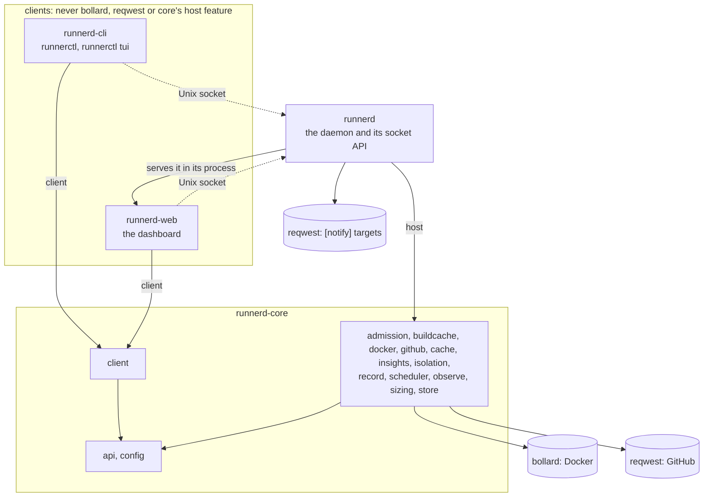

# Architecture

Where things live and which rules hold them together. The why behind each rule is in [`docs/adr`](docs/adr/README.md).

## Crates

Solid arrows are Cargo dependencies, labelled with the features they turn on; dotted ones are requests at run time.

| Crate | Path | Owns | May depend on |
|---|---|---|---|
| `runnerd-core` | `crates/core` | config, API types, the socket client every client uses, scheduling, Docker and GitHub clients, caches, the shared build cache's server, job history, sizing advice, insights, admission by measured peaks and CPU | anything; Docker and GitHub only behind the `host` feature, Tokio behind `host` or `client`, hyper's client behind `client` and its server behind `host` |
| `runnerd` | `crates/daemon` | the daemon binary: `init`, `serve`, `stop`, `doctor`, `check-config`, `simulate`, the Unix-socket API, the notifications `[notify]` asks for | `runnerd-core` with `host`; `runnerd-web`, which it serves and whose `Sessions` it hands the sign-out and pairing routes; hyper for a shell's upgraded connection |
| `runnerd-cli` | `crates/cli` | the command-line client, binary `runnerctl`: `human` (text), `watch`, `tui` (full-screen dashboard, `tui` feature), `output` (the only printing) | `runnerd-core` with `client`, without `host`; `ratatui` for the TUI, `rustix` for the TUI and a shell's raw terminal |
| `runnerd-web` | `crates/web` | the web dashboard: pages, charts, live updates, its session | `runnerd-core` with `client`, without `host` |
| `runnerd-fixtures` | `crates/fixtures` | tests only: the daemon data every client's parity test draws, and the facts core computes from it ([ADR 0062](docs/adr/0062-client-parity-is-checked.md)); not published | `runnerd-core` without `host`; clients take it as a dev-dependency only |
| `runnerd-wire-compat` | `crates/wire-compat` | tests only: this version and the previous release read each other's JSON ([ADR 0061](docs/adr/0061-the-previous-release-reads-the-wire.md)); a workspace of its own | `runnerd-core` without `host`, and the previous release's, pinned by commit |

`runnerd-core` modules:

- `api`, `config`: build without `host`. Every client reads these.
- `client`: the `client` feature. HTTP over the socket, timeouts and the event stream with its reconnects, for every
  client ([ADR 0030](docs/adr/0030-one-socket-client-in-core.md)).
- `admission`, `buildcache`, `docker`, `github`, `cache`, `insights`, `isolation`, `record`, `scheduler`, `observe`,
  `sizing`, `store`: `host` only
  ([`crates/core/src/lib.rs`](crates/core/src/lib.rs)). `admission` predicts a job's memory peak and average CPU,
  replays the history for `runnerd simulate`, and works out what the host's memory leaves the slice
  (`admission::host`, [ADR 0055](docs/adr/0055-admission-follows-the-hosts-memory.md)); `sizing` turns the history into advice, and `sizing::auto` picks
  the changes auto sizing makes; `insights` reads the history for jobs that got slower, are flaky or near their cap,
  and the waits of each week ([ADR 0051](docs/adr/0051-insights-and-notifications.md)). All three are pure: the
  engine and the daemon read the store and act on what they return. `buildcache` keeps the build cache every runner
  shares and serves it on one Unix socket per runner; the engine tells it whether a runner's job may write
  ([ADR 0052](docs/adr/0052-shared-build-cache.md)).

`runnerd` modules: `api` (the socket's routes; `api/auto` runs auto sizing, `api/notify` sends `[notify]`'s
notifications), `init`, `doctor`, `simulate`, and
`output`, the only module that prints. The main `runnerd-web` modules: `auth` (the session secret, the login links and pairing codes, and the `Origin`
check), `views` (one per page), `live` (each page's event stream), `actions` (the writes, passed on to the API), and
`assets` (the files the pages load, the web app manifest and icons included).

The web dashboard (`crates/web`) is a client like `runnerctl`: the daemon runs it in its process, but it reads and
writes only through the API on the Unix socket ([ADR 0020](docs/adr/0020-dashboard-is-an-api-client-on-loopback.md)).
The optional tray client (`crates/desktop`, [ADR 0034](docs/adr/0034-desktop-framework.md)) will be another.
[`.github/scripts/check-boundaries.sh`](.github/scripts/check-boundaries.sh) fails CI when any workspace crate other
than `runnerd` and `runnerd-core` builds `bollard`, `reqwest` or core's `host` feature, and when the cli, the
dashboard or the daemon defines its own formatter or classifier for a fact core owns ([ADR
0062](docs/adr/0062-client-parity-is-checked.md)).

## Request path

client → transport → principal → handler → core

1. A client sends JSON over the daemon's Unix socket (`$XDG_RUNTIME_DIR/runnerd.sock`).
2. The transport ([`crates/daemon/src/api.rs`](crates/daemon/src/api.rs)) reads the peer's credentials and turns
   them into an `api::Principal` in one extractor, `Authenticated`. Only the user the daemon runs as gets through.
3. Handlers take that principal, read `Handle::status` or the job store (`Handle::store`), or call `Control`
   (pause, resume, reseed, cache clean, remove records, open a shell, reload, shutdown). `GET /v1/events` streams
   the store's events as server-sent events. The config routes
   ([`crates/daemon/src/api/control.rs`](crates/daemon/src/api/control.rs)) validate a new config and hand the
   engine the parsed config with a `Commit` that writes the file; the engine runs the commit between ticks and runs
   with the config before its next tick, only if the file was written. Under `[sizing] auto`,
   [`crates/daemon/src/api/auto.rs`](crates/daemon/src/api/auto.rs) applies sizing advice through the same function
   every 5 minutes ([ADR 0039](docs/adr/0039-auto-sizing.md)).
   `POST /v1/records/{job}/shell` ([`crates/daemon/src/api/records.rs`](crates/daemon/src/api/records.rs)) answers
   `101 Switching Protocols` and carries the shell's terminal over the same connection
   ([ADR 0031](docs/adr/0031-records-of-failed-jobs.md)).
4. The engine ([`crates/core/src/scheduler/engine.rs`](crates/core/src/scheduler/engine.rs)) owns all slot state.
   It publishes `api::Status` after every tick and command and takes commands only through `Control`: a command
   that needs slot state is a `Command` on a channel the engine answers between ticks, or while a tick waits for
   GitHub's listings and job reads, never in the middle of applying them
   ([ADR 0026](docs/adr/0026-commands-answered-while-a-tick-waits-for-github.md)).
   `engine.rs` holds `Engine`'s state, its construction and its loop; each submodule of
   [`engine/`](crates/core/src/scheduler/engine) adds one concern's methods: `recover` (startup), `tick` (polling
   and planning), `runners` (a slot's runner from start to removal), `images` (pulling the profiles' images and removing the published runner images none runs,
   [ADR 0040](docs/adr/0040-unused-runner-images-removed.md)),
   `caches` (reseeds, the mirror, the shared caches), `build_cache` (a runner's socket of the build cache, and
   whether its job may write), `records` (records of failed jobs and the shells in them),
   `history` (what the store records), `admission` (what a new runner reserves), `warm` (how many warm runners each
   repository wants, from `scheduler::warm`), `control` (`Control` and the commands) and `status` (what it
   publishes).

A new transport (SSH, Tailscale) produces a `Principal` and reuses the handlers.

The dashboard's path is browser → loopback TCP → session check → `runnerd-web` → Unix socket → the path above. Its
session check ([`crates/web/src/auth.rs`](crates/web/src/auth.rs)) admits a request only with the session cookie, and
a write only with the dashboard's own `Origin` or one of `[web] origins`, the proxies the owner runs in front of it
([ADR 0042](docs/adr/0042-dashboard-behind-a-proxy-and-installable.md)); the daemon then sees the dashboard as its
own user. A browser signed in stays signed in across restarts: the session secret is a file the daemon keeps,
and `POST /v1/dashboard/sign-out` on the socket replaces it with every code made before;
`POST /v1/dashboard/pairings` makes 5-minute links bound to one of `[web] origins` for `runnerctl web --qr`
([ADR 0043](docs/adr/0043-phones-paired-by-qr-code-and-sessions-that-last.md)). `GET /v1/dashboard` serves `[web] open`
as the daemon read it at start, the origin `runnerctl web` opens
([ADR 0042](docs/adr/0042-dashboard-behind-a-proxy-and-installable.md)).

## Job lifecycle

queued → slot → container → removed

1. Every `poll_interval` the engine asks GitHub for runners first, then queued jobs (`Engine::tick`; the order
   avoids starting a second runner for a job its runner just took), every repository at once, a few requests at a
   time.
2. `scheduler::plan`, a pure function, picks a free slot per queued job within the memory budget, in the profile of
   the repository's pool whose labels match the job (each `[[repositories]]` entry is a pool;
   [ADR 0058](docs/adr/0058-a-repository-served-by-several-profiles.md)): what each
   runner reserves is its cap, or under `admission = "measured"` its predicted peak (`engine/admission`,
   [ADR 0033](docs/adr/0033-measured-admission.md)), within what the host's memory leaves the slice
   ([ADR 0055](docs/adr/0055-admission-follows-the-hosts-memory.md)), and under `cpu_overcommit` within the CPU
   budget too ([ADR 0038](docs/adr/0038-cpu-admission.md)). A profile whose
   `image` Docker lacks starts nothing until the engine pulled it in the background
   ([ADR 0025](docs/adr/0025-published-runner-images-named-by-reference.md)). For each job it leaves queued it says
   why, which the status passes on ([ADR 0044](docs/adr/0044-queued-jobs-say-why-they-wait.md)). A job that does
   not fit takes the room of warm runners of other repositories, which stop; once every job it can start has its
   runner and none waits for room, it starts the warm runners each active repository wants
   (`scheduler::warm`: `[[repositories]] warm` in its active hours, plus the jobs its workflow runs seen so far are
   expected to queue still), so a job finds a runner already registered
   ([ADR 0050](docs/adr/0050-warm-runners.md)).
3. `Engine::start` prepares the slot's volumes, registers a JIT runner (`GithubApi::jit_config`), opens the runner's
   build cache socket and starts its container (`DockerApi::start`) under the profile's limits and isolation
   backend.
4. The runner takes one job and exits; the image's entrypoint then deletes the runner's credentials and every
   dot-file in its home and file in `/tmp` the job added or changed (`image/scrub.sh`). `Engine::collect_finished` sees the container stopped, removes it and the runner's
   registration, and frees the slot. A runner that took no job holds the repository back for a while. If the job
   failed and its profile has `record_failures`, the engine first commits the container to a record
   (`runnerd-record:<job>`) within `[records]`' limits, then removes it
   ([ADR 0031](docs/adr/0031-records-of-failed-jobs.md)).
5. While a job runs the engine records it in the store: the job's ID from the runner's `_diag` Worker log
   (`observe::capture`, run in the container with `docker exec`), its steps from `GithubApi::job`, its log from the
   runner's `_diag/pages`, CPU, memory and `memory.events` from the container's cgroup every 2 s (`observe::metrics`,
   which reads the host's `/proc/meminfo` and `/proc/pressure/memory` beside them, and every 30 s the name and
   memory of each process outside the slice, never its command line
   ([ADR 0057](docs/adr/0057-name-what-holds-the-hosts-memory.md))), and the
   mirror's bytes from its access log (`observe::mirror`), and the build cache's counts when the runner is removed. The record is final once GitHub reports the job completed
   and the container is gone, or 15 minutes after the container is gone (`lost`).
6. When a profile is idle after its slot 1 ran a job, or after the caches' check measured its snapshot over
   `[caches] snapshot_max`, `cache::reseed` makes slot 1's layers the profile's snapshot, which starts over above
   that limit ([ADR 0041](docs/adr/0041-snapshot-and-mirror-limits.md)).

On start the engine adopts the runner and seed containers a previous daemon left (`Engine::recover`) and schedules
nothing until Docker has listed them. A running runner in a slot, profile or repository the config no longer has is
adopted too and drains as it would after a reload.

## State

| What | Where |
|---|---|
| Config | `runnerd.toml`, default `$XDG_CONFIG_HOME/runnerd/runnerd.toml` ([`crates/core/src/config.rs`](crates/core/src/config.rs)) |
| Slot and repository state | in memory, in `Engine`; rebuilt from container labels on restart, except paused repositories, which the job history keeps |
| Caches | Docker volumes named by `cache::Names`: `runnerd-<profile>-base`, `runnerd-<profile>-slot-<n>`, `runnerd-pnpm`, `runnerd-maven`, `runnerd-mirror` |
| Build cache | files in `[caches.build] directory`, default `$XDG_CACHE_HOME/runnerd/build-cache`, under `entries/<owner>/<name>/<tool>/<key>`; each running runner's socket in `runnerd-build-cache/<hash of its name>/cache.sock` beside the API socket; which runners may write, in memory |
| Runner containers | labelled `runnerd.job`, `runnerd.profile`, `runnerd.slot`, `runnerd.repository`, `runnerd.runner-id` |
| Records of failed jobs | Docker images `runnerd-record:<job>`, labelled `runnerd.record` with the job's ID, repository, profile, name and when it was made; shells in them are containers labelled `runnerd.shell` |
| Budget | the systemd slice's `MemoryMax`, read with `systemctl`; the host's memory, its latest reading kept in the store's memory, not stored |
| Dashboard session | the secret in `dashboard-session` beside the job history (0600), kept across restarts; a one-time login link per address in `runnerd.web` next to the socket (0600); pairing codes in memory, 5 minutes each, bound to one origin |
| Job history | SQLite, default `$XDG_STATE_HOME/runnerd/runnerd.db` (`store::Store`); jobs, runners, steps, samples, logs, events, cache sizes, what the build cache did for each runner, paused repositories, what became of each record, auto sizing's changes, where each `[notify]` target got to, how long each job waited for the host's memory; times in ms |

## Invariants

- API types live only in `runnerd-core::api`. Clients deserialize the same types the daemon serializes.
- The previous release reads what this version writes, and this version what it wrote, unless an ADR accepts the
  break (`crates/wire-compat`, [ADR 0061](docs/adr/0061-the-previous-release-reads-the-wire.md)).
- What clients show of the same thing is computed once in `runnerd-core::api`: a job's outcome and whether it
  failed, its steps' outcomes, how long it waited and ran, its phases, its name, its peaks as samples come in, its
  latest runs compared, and how durations, ages, CPU time and cores in use are written (`api::jobs::facts`,
  `api::units`). So is what they show of the host: the budget's lines and the parts its bar draws, each slot's state
  and the slots' health, the sizing advice and auto sizing's next step, a config check's verdict and budget, doctor's
  badges, insights and the digest, caches, the build cache and records, the history's daily statistics, and what an
  action did. Core returns the label, the figure and its kind or `api::Tone`; the dashboard, the TUI and `runnerctl`
  only draw them ([ADR 0059](docs/adr/0059-clients-show-what-core-computes.md),
  [ADR 0060](docs/adr/0060-clients-show-what-core-computes-about-the-host.md)). Every client's parity test draws
  the same fixtures (`crates/fixtures`) and asserts core's facts, and the boundary check fails on a client's own
  formatter or classifier ([ADR 0062](docs/adr/0062-client-parity-is-checked.md)).
- Clients never talk to Docker or GitHub; they talk to the daemon.
- The GitHub token stays inside `github::Github`: never in a log line, a `Debug` output or an error. A `[notify]`
  target's URL and header values (`config::Secret`) are as secret: only the request that sends a message reads them,
  and `GET /v1/config` answers them as `<secret>` (`config::mask_secrets`), which `PUT /v1/config` and the check
  put back (`config::keep_secrets`), so no client holds them.
- Nothing leaves the machine but GitHub's and Docker's requests, unless `[notify]` names targets. The notifier
  (`api/notify`) reads the store's durable events and the history off the engine's loop; the engine never waits
  for it, and a target's cursor moves only once a delivery succeeded
  ([ADR 0051](docs/adr/0051-insights-and-notifications.md)).
- A runner's build cache uploads become entries only once GitHub says its job runs on that runner and is a push,
  schedule or manual run of the repository itself on its default branch or one of `[caches.build] branches`, of a
  commit that branch has, or, where `build_cache_writers = "pull-requests"`, a `pull_request` run of the
  repository's own branch whose pull request, push and run people, not bots, made, of a commit that branch has
  ([ADR 0053](docs/adr/0053-build-cache-written-by-own-pull-requests.md)); until then they are held, at most
  `max_size` of them in all and a quarter of it per job, and otherwise dropped, answered as stored. A runner reads
  only its repository's entries, through its own socket. The cache is trimmed only while no runner runs
  ([ADR 0052](docs/adr/0052-shared-build-cache.md)).
- A JIT config reaches a container only as a root-only file (`docker::JIT_CONFIG_PATH`), never the create request
  or a log line.
- The engine deletes only GitHub runner registrations whose names start with this machine's prefix
  (`HostIdentity::prefix`); other machines serve the same repositories. Runner containers on the local Docker are
  this machine's whatever their name: `Engine::recover` adopts or removes them without checking the prefix.
- `scheduler::plan` and `scheduler::warm` do no I/O and read no clock.
- No two pools of a repository share a label or a profile (`Config::check_pools`), so at most one pool matches a
  job. Admission, CPU holds, holds after failed runners, warm runners and runner registration go by the pool
  (repository and slot's profile), pause by the repository; a job no pool matches waits with `Waiting::NoPool`
  ([ADR 0058](docs/adr/0058-a-repository-served-by-several-profiles.md)).
- A warm runner never holds back a queued job: it starts only with room no job waits for, and gives a job its slot,
  memory and CPU.
- A warm runner never holds back upkeep: a reseed, or the shared caches' check an hour after the last, stops idle
  warm runners and starts none until it runs. A due reseed whose seed would not fit even once they stop leaves
  them waiting ([ADR 0063](docs/adr/0063-a-warm-runners-room-pays-the-hosts-deficit-first.md)).
- Only the store's writer thread writes the database; every write goes through `Store`'s queue, in order. The one
  exception is pruning, which only deletes, on its own connection, a batch per transaction
  ([ADR 0027](docs/adr/0027-pruning-runs-beside-the-writer.md)).
- Host samples reach subscribers when taken and the database a minute's worth at a time; reads include the ones not
  yet stored.
- A durable event (every kind but `job.sample`, `host.sample` and `log.line`) is stored in the same transaction as
  the change it announces and broadcast only after it commits, so its ID is a position a client can resume from
  with `Last-Event-ID`.
- The store keeps each profile's and repository's latest `profile.*` and `repository.*` event through pruning. A
  started engine announces what differs from them and every slot, so a client resuming after the last run's events
  ends where `/v1/status` is ([ADR 0029](docs/adr/0029-profile-events-and-what-a-restart-announces.md)).
- The engine does not start a runner for a queued job one of its runners holds, whatever GitHub's queue says.
- A reload never stops a running job: slots a new config removes go once their runners finish, and a profile starts
  no runner while it runs as many as its configured `slots` (`scheduler::Slot::Closed`).
- A forced pause cancels runs only of jobs this daemon's runners hold, and only of the paused repositories.
- `Control` records the paused repositories in the store, under the lock that changes them, and answers a pause or
  resume once the record commits, or fails it (`ControlError::NotRecorded`, 500) if it does not; the engine starts
  with the recorded ones paused, minus those its config lacks, so a paused repository gets no runner after a restart.
- Sizing advice (`GET /v1/sizing`, `sizing::advise`) is computed from the job history. A client applies it on
  request, after a confirmation, through `PUT /v1/config`
  ([ADR 0032](docs/adr/0032-sizing-advice-from-sampled-peaks.md)). Under `[sizing] auto` the daemon applies what
  `sizing::auto::changes` picks through the same check and commit (`api::control::replace`): `memory`, `slots` and
  `cpus`, one change per profile at a time, a raise at most once per `[sizing] raise_interval` and a lowering once
  per `interval` ([ADR 0049](docs/adr/0049-auto-sizing-without-hand-tuning.md)), never lowering a profile a run met
  the cap of, never leaving a profile's bounds,
  and never writing a file that changed on disk or a config without a slot a runner is in (the engine checks it
  before the commit). Each change is recorded as pending in the history, synced to disk, before its file is written,
  then done (with a durable `sizing.changed` event) or failed; a pending one is settled at every look, auto sizing
  on or off, as done or uncertain, never failed ([ADR 0039](docs/adr/0039-auto-sizing.md)).
- `PUT /v1/config?revision=` refuses a text made from another revision than the config runnerd runs with, or sent
  while the file on disk is not that revision's text, so an editor opened before a change cannot save over it.
- What the running containers reserve, a new runner's reservation with them, fits the slice's `MemoryMax`. Under
  `admission = "caps"` a runner reserves its cap and the config check holds `slots × memory` over all profiles,
  with the mirror, to `MemoryMax`, and every runner counts at its cap, whatever it reserved before a reload. Under
  `admission = "measured"` a runner reserves its predicted peak, at most its cap, and counts at the larger of that
  and its last sampled memory, or at its cap when its own or the slice's sample is older than three intervals; the
  reservation follows its pool's queue until its job is known, then that job's prediction, and a waiting
  runner raised past what is free is stopped. The config check holds only one runner of each profile with the mirror to `MemoryMax`; nothing
  starts while the slice's sampled memory is at 90% of it; and a runner reserves its cap without a recent sample,
  after a run of its job out of memory at its cap or killed for memory, or when a restart adopted it without a
  record of what it reserved ([ADR 0033](docs/adr/0033-measured-admission.md),
  [ADR 0056](docs/adr/0056-adopted-runners-keep-their-reservations.md)). Job memory samples leave out page cache, and
  predictions learn peaks only from runners sampled that way ([ADR 0037](docs/adr/0037-memory-without-page-cache.md)). Each runner's record keeps what it reserves and why.
- Under either policy, what the running containers reserve, a new runner's reservation with them, also fits what
  the host's memory leaves the slice, from a reading of the last three intervals: the slice's memory without page
  cache or reclaimable slab plus `MemAvailable`, less a margin of the larger of 2G and a sixteenth of the host's
  memory, half again as much while a job waits for it and a runner runs; and nothing starts while the host has under
  twice the margin available and `full` memory pressure over 10 s is at 5%, until it is under 1%. No runner is
  stopped for the host. Each job's record adds up how long it waited for it, and sizing takes that out of its wait.
  Sizing never advises a cap under the largest peak plus 1G
  ([ADR 0055](docs/adr/0055-admission-follows-the-hosts-memory.md)). A job takes a stopped warm runner's room only
  once its reservation paid the host's deficit, and a seed container starts only where its cap fits the slice, the
  host and, under measured admission, the high-water mark; a requested reseed's cap counts in the budget once its
  profile drained ([ADR 0063](docs/adr/0063-a-warm-runners-room-pays-the-hosts-deficit-first.md)).
- Under `[host] cpu_overcommit`, what the runners reserve of CPU, a new runner's with them, fits the slice's CPUs
  times the factor: each its profile's `cpus`, or under measured admission its job's predicted average CPU, at most
  the whole budget; under caps every runner counts at its CPU limit. The mirror, seeds and shells reserve none, no
  runner is stopped for CPU, and a job held 2 minutes for CPU stops younger starts until it fits
  ([ADR 0038](docs/adr/0038-cpu-admission.md)).
- The config file is replaced only by a config that validates against the slice's `MemoryMax`, by a temporary file
  renamed over it, and the engine runs a config only once its file is in place: no tick runs between the two.
- After a restart, the memory caps of adopted runners, seed containers and the mirror come from Docker, not the
  config, which a reload may have lowered since they started.
- No record keeps the JIT config, `_work/_temp`, a git config's `extraheader`, or any dot-file in the runner's home
  (but the Rust toolchain's `~/.rustup` and `~/.cargo/{bin,registry,git}`) or file in `/tmp` or `/var/tmp` the job
  added or changed: the runner image deletes them when the runner exits, and
  the engine commits no container whose changes still hold one (`record::secrets_left`). Checking and committing a
  container run off the engine's loop.
- A file in the cache layer that may hold a token (`CACHE_SECRETS` in `image/layers.sh`: cargo's credentials and
  config, Gradle's `gradle.properties`) never reaches the next job in the slot, a record shell or a new snapshot,
  including one an older snapshot holds ([ADR 0035](docs/adr/0035-runner-image-stages.md)).
- A slot's Docker Engine keeps its images and build cache on the slot's volume, given to dockerd as `--data-root`
  and never in `daemon.json`, where sysbox would mount a directory of its own over it. The slots' stores together
  stay within a quarter of Docker's disk not otherwise used: the engine gives each runner its share as
  `RUNNERD_DOCKER_BUDGET_GB` (measured at start and with every check of the caches), the image's job cleanup trims
  the build cache and then empties a store still over it, and the check removes the volumes of slots past their
  profile's count. A store whose engine does not start is emptied
  ([ADR 0054](docs/adr/0054-slot-docker-stores-share-the-disk.md)).
- A shell's container counts against the budget like a slot and is refused when the budget cannot hold it. It
  mounts the shared caches read-only, and its profile does not reseed while it is open. It is removed when its shell
  exits, its client goes away, after 8 hours, or when the daemon stops; `Engine::recover` removes any left over.
  A record with a shell open is never removed.
- The dashboard listens on loopback only, never logs or shows in `Debug` its session secret or a login code, and serves every file its
  pages load, its web app manifest and icons included; its Content-Security-Policy allows nothing else. Other
  devices reach it only through a proxy the owner runs, whose origin `[web] origins` lists.
