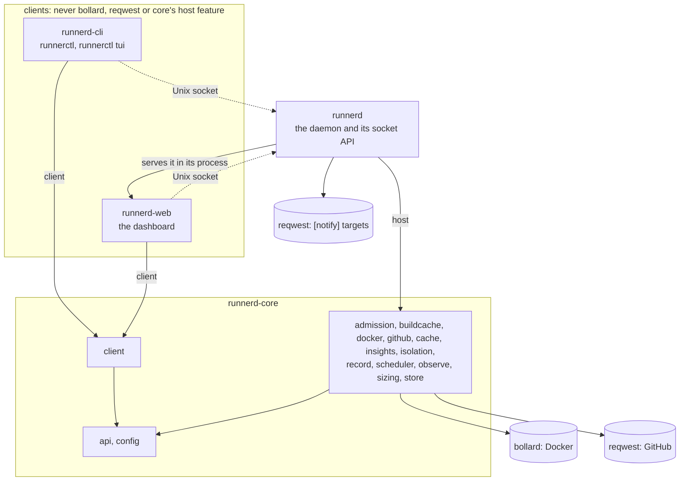

# Architecture

Where things live and which rules hold them together. The why behind each rule is in [`docs/adr`](docs/adr/README.md).

## Crates

Solid arrows are Cargo dependencies, labelled with the features they turn on; dotted ones are requests at run time.

| Crate | Path | Owns | May depend on |
|---|---|---|---|
| `runnerd-core` | `crates/core` | config, API types, the socket client every client uses, scheduling, Docker and GitHub clients, caches, the shared build cache's server, job history, sizing advice, insights, admission by measured peaks and CPU | anything; Docker and GitHub only behind the `host` feature, Tokio behind `host` or `client`, hyper's client behind `client` and its server behind `host` |
| `runnerd` | `crates/daemon` | the daemon binary: `init`, `serve`, `stop`, `doctor`, `check-config`, `simulate`, the Unix-socket API, the notifications `[notify]` asks for | `runnerd-core` with `host`; `runnerd-web`, which it serves and whose `Sessions` it hands the sign-out and pairing routes; hyper for a shell's upgraded connection |
| `runnerd-cli` | `crates/cli` | the command-line client, binary `runnerctl`: `human` (text), `watch`, `tui` (full-screen dashboard, `tui` feature; `tui/draw` has a module per view), `output` (the only printing) | `runnerd-core` with `client`, without `host`; `ratatui` for the TUI, `rustix` for the TUI and a shell's raw terminal |
| `runnerd-web` | `crates/web` | the web dashboard: pages, charts, live updates, its session | `runnerd-core` with `client`, without `host` |
| `runnerd-fixtures` | `crates/fixtures` | tests only: the daemon data every client's parity test draws, and the facts core computes from it ([ADR 0062](docs/adr/0062-client-parity-is-checked.md)); not published | `runnerd-core` without `host`; clients take it as a dev-dependency only |
| `runnerd-wire-compat` | `crates/wire-compat` | tests only: this version and the previous release read each other's JSON ([ADR 0061](docs/adr/0061-the-previous-release-reads-the-wire.md)); a workspace of its own | `runnerd-core` without `host`, and the previous release's, pinned by commit |

`runnerd-core` modules:

- `api`, `config`: build without `host`. Every client reads these. `api::View` and `api::Column` name the views and table columns every client uses, `Health::figures` and
  `JobMetrics::totals` word the overview's health figures and what a job used
  ([ADR 0093](docs/adr/0093-clients-share-views-columns-and-health-figures.md)). `api::savings` prices this machine's job minutes
  at GitHub's per-minute rates and words the figure ([ADR 0072](docs/adr/0072-job-minutes-priced-at-github-hosted-rates.md));
  the daemon passes it the history and the config, and the store keeps each repository's visibility, which the
  engine asks GitHub for once a day in a task of its own, off the tick.
- `client`: the `client` feature. HTTP over the socket, timeouts and the event stream with its reconnects, for every
  client ([ADR 0030](docs/adr/0030-one-socket-client-in-core.md)).
- `admission`, `buildcache`, `docker`, `github`, `cache`, `insights`, `isolation`, `record`, `scheduler`, `observe`,
  `sizing`, `store`: `host` only
  ([`crates/core/src/lib.rs`](crates/core/src/lib.rs)). `admission` predicts a job's memory peak and average CPU,
  replays the history for `runnerd simulate`, and works out what the host's memory leaves the slice
  (`admission::host`, [ADR 0055](docs/adr/0055-admission-follows-the-hosts-memory.md)); `admission::recent` reads
  each job's recent runs, the one window both admission and sizing read memory from
  ([ADR 0070](docs/adr/0070-predictions-follow-recent-runs.md)); `sizing` turns the history into advice,
  `sizing::memory` says what a raise and a lowering of `memory` read and which lowering went too far, and
  `sizing::auto` picks the changes auto sizing makes, under `measured` adding slots on waits for a slot alone
  (`scheduler::Plan::slot_waiting`, which the engine adds up per job) as far as the engine's last measure of Docker's
  disk (`Handle::disk`) allows ([ADR 0090](docs/adr/0090-slots-follow-waits-for-a-slot-alone-and-dockers-disk.md)); `insights` reads the history for jobs that got slower, are flaky or near their cap,
  and the waits of each week ([ADR 0051](docs/adr/0051-insights-and-notifications.md)), and for jobs their CPU cap
  holds back by the rule sizing reads, `sizing::Throttling::held` ([ADR 0087](docs/adr/0087-an-insight-for-jobs-their-cpu-cap-holds-back.md)). All three are pure: the
  engine and the daemon read the store and act on what they return. `buildcache` keeps the build cache every runner
  shares and serves it on one Unix socket per runner; the engine tells it whether a runner's job may write
  ([ADR 0052](docs/adr/0052-shared-build-cache.md)), and the branches its run and repository have to do with.
  `buildcache::actions` serves GitHub Actions' cache service on the same socket from the same entries, and passes
  every other request of GitHub's results service to GitHub
  ([ADR 0082](docs/adr/0082-github-actions-cache-served-from-the-host.md)). `buildcache::turbo` answers the rest of
  Turborepo's remote cache API, whose artifacts, like Nx's, are entries as Gradle's are, and passes a request with a
  workflow's own token to Vercel's API
  ([ADR 0083](docs/adr/0083-turborepo-and-nx-from-the-build-cache.md)).

`runnerd` modules: `api` (the socket's routes; `api/auto` runs auto sizing, `api/notify` sends `[notify]`'s
notifications, each kind of target a `Sender` in a module of its own), `init`, `doctor`, `simulate`, and
`output`, the only module that prints. The main `runnerd-web` modules: `auth` (the session secret, the login links and pairing codes, and the `Origin`
check), `views` (one per page: overview, history, records, sizing, insights, caches, config, and a job), `live` (each page's event stream), `actions` (the writes, passed on to the API), and
`assets` (the files the pages load, the web app manifest and icons included).

The web dashboard (`crates/web`) is a client like `runnerctl`: the daemon runs it in its process, but it reads and
writes only through the API on the Unix socket ([ADR 0020](docs/adr/0020-dashboard-is-an-api-client-on-loopback.md)).
The optional tray client (`crates/desktop`, [ADR 0034](docs/adr/0034-desktop-framework.md)) will be another.
[`.github/scripts/check-boundaries.sh`](.github/scripts/check-boundaries.sh) fails CI when any workspace crate other
than `runnerd` and `runnerd-core` builds `bollard`, `reqwest` or core's `host` feature, and when the cli, the
dashboard or the daemon defines its own formatter or classifier for a fact core owns ([ADR
0062](docs/adr/0062-client-parity-is-checked.md)).

## Request path

client → transport → principal → handler → core

1. A client sends JSON over the daemon's Unix socket (`$XDG_RUNTIME_DIR/runnerd.sock`).
2. The transport ([`crates/daemon/src/api.rs`](crates/daemon/src/api.rs)) reads the peer's credentials and turns
   them into an `api::Principal` in one extractor, `Authenticated`. Only the user the daemon runs as gets through.
3. Handlers take that principal, read `Handle::status` or the job store (`Handle::store`), or call `Control`
   (pause, resume, reseed, cache clean, remove records, open a shell, reload, shutdown). `GET /v1/events` streams
   the store's events as server-sent events. The config routes
   ([`crates/daemon/src/api/control.rs`](crates/daemon/src/api/control.rs)) validate a new config and hand the
   engine the parsed config with a `Commit` that writes the file; the engine runs the commit between ticks and runs
   with the config before its next tick, only if the file was written. Under `[sizing] auto`,
   [`crates/daemon/src/api/auto.rs`](crates/daemon/src/api/auto.rs) applies sizing advice through the same function
   every 5 minutes ([ADR 0039](docs/adr/0039-auto-sizing.md)).
   `POST /v1/records/{job}/shell` ([`crates/daemon/src/api/records.rs`](crates/daemon/src/api/records.rs)) answers
   `101 Switching Protocols` and carries the shell's terminal over the same connection
   ([ADR 0031](docs/adr/0031-records-of-failed-jobs.md)).
4. The engine ([`crates/core/src/scheduler/engine.rs`](crates/core/src/scheduler/engine.rs)) owns all slot state.
   It publishes `api::Status` after every tick and command and takes commands only through `Control`: a command
   that needs slot state is a `Command` on a channel the engine answers between ticks, or while a tick waits for
   GitHub's listings and job reads, never in the middle of applying them
   ([ADR 0026](docs/adr/0026-commands-answered-while-a-tick-waits-for-github.md)).
   `engine.rs` holds `Engine`'s state, its construction and its loop; each submodule of
   [`engine/`](crates/core/src/scheduler/engine) adds one concern's methods: `recover` (startup), `tick` (polling
   and planning), `runners` (a slot's runner from start to removal), `images` (pulling the profiles' images and removing the published runner images none runs,
   [ADR 0040](docs/adr/0040-unused-runner-images-removed.md)),
   `caches` (reseeds, the mirror, the shared caches), `build_cache` (a runner's socket of the build cache, and
   whether its job may write), `records` (records of failed jobs and the shells in them),
   `history` (what the store records), `admission` (what a new runner reserves), `warm` (how many warm runners each
   repository wants, from `scheduler::warm`), `control` (`Control` and the commands) and `status` (what it
   publishes).

A new transport (SSH, Tailscale) produces a `Principal` and reuses the handlers.

The dashboard's path is browser → loopback TCP → session check → `runnerd-web` → Unix socket → the path above. Its
session check ([`crates/web/src/auth.rs`](crates/web/src/auth.rs)) admits a request only with the session cookie, and
a write only with the dashboard's own `Origin` or one of `[web] origins`, the proxies the owner runs in front of it
([ADR 0042](docs/adr/0042-dashboard-behind-a-proxy-and-installable.md)); the daemon then sees the dashboard as its
own user. A browser signed in stays signed in across restarts: the session secret is a file the daemon keeps,
and `POST /v1/dashboard/sign-out` on the socket replaces it with every code made before, and ends the live pages
signed in with the old one ([ADR 0078](docs/adr/0078-a-first-run-that-can-start-and-keeps-its-secrets.md));
`POST /v1/dashboard/pairings` makes 5-minute links bound to one of `[web] origins` for `runnerctl web --qr`
([ADR 0043](docs/adr/0043-phones-paired-by-qr-code-and-sessions-that-last.md)). `GET /v1/dashboard` serves `[web] open`
as the daemon read it at start, the origin `runnerctl web` opens
([ADR 0042](docs/adr/0042-dashboard-behind-a-proxy-and-installable.md)).

## Job lifecycle

queued → slot → container → removed

1. Every `poll_interval` the engine asks GitHub for runners first, then queued jobs (`Engine::tick`; the order
   avoids starting a second runner for a job its runner just took), every repository at once, a few requests at a
   time. Each listing is read page by page, up to 10 pages; one repository's queued-jobs poll reads the jobs of at
   most 200 runs, queued runs before those in progress and the oldest first in each. A repository a reload removed
   is polled until two listings in a row show none of this machine's runners. The history keeps when a listing first
   showed each job queued (`seen_at`), written as each listing answers, so a runner that takes the job before the
   other listings answer, or a tick that ends meanwhile, keeps it; job pages show it as "Seen by runnerd" between
   its queueing and its container's start ([ADR 0092](docs/adr/0092-idle-removals-and-deferred-starts-stay-off-the-start-path.md)).
2. `scheduler::plan`, a pure function, picks a free slot per queued job within the memory budget, in the profile of
   the repository's pool whose labels match the job (each `[[repositories]]` entry is a pool;
   [ADR 0058](docs/adr/0058-a-repository-served-by-several-profiles.md)): what each
   runner reserves is its cap, or under `admission = "measured"` its predicted peak (`engine/admission`,
   [ADR 0033](docs/adr/0033-measured-admission.md)), within what the host's memory leaves the slice
   ([ADR 0055](docs/adr/0055-admission-follows-the-hosts-memory.md); with `[host] memory_ceiling` counting what an
   elastic VM can still grow by, [ADR 0084](docs/adr/0084-a-host-whose-memory-grows-to-a-ceiling.md)), and under
   `cpu_overcommit` within the CPU
   budget too ([ADR 0038](docs/adr/0038-cpu-admission.md)). Among the free slots a job takes the one that ran the
   same job last, else one that ran its repository, else the lowest; the engine keeps each slot's last job
   (`Engine::ran`, rebuilt from the history at start, dropped by a reseed that replaced the snapshot) and never
   waits for the preferred slot ([ADR 0080](docs/adr/0080-a-job-starts-in-the-slot-that-ran-it-last.md)). A profile whose
   `image` Docker lacks starts nothing until the engine pulled it in the background
   ([ADR 0025](docs/adr/0025-published-runner-images-named-by-reference.md)). For each job it leaves queued it says
   why, which the status passes on ([ADR 0044](docs/adr/0044-queued-jobs-say-why-they-wait.md)). A job that does
   not fit takes the room of warm runners of other repositories, which stop; once every job it can start has its
   runner and none waits for room, it starts the warm runners each active repository wants
   (`scheduler::warm`: `[[repositories]] warm` in its active hours, plus the jobs its workflow runs seen so far are
   expected to queue still), so a job finds a runner already registered
   ([ADR 0050](docs/adr/0050-warm-runners.md)).
3. The plan's stops go first, all at once (`Engine::remove_idle`): each idle runner is deregistered, then the
   containers are removed together, then their log captures end; a runner GitHub says just took a job stays, as
   does one whose capture names a job by then or whose registration was already gone and whose log shows a job (its job may have ended, so it
   ends as a busy runner does, its log read and its failed job recorded first), and a slot stays held until Docker
   confirms its container's removal. Each record says why its runner was removed and
   why it started (`job`, `warm`, `burst`). Then, one at a time, `Engine::start` prepares the slot's volumes,
   registers a JIT runner (`GithubApi::jit_config`), opens the runner's build cache socket and starts its container
   (`DockerApi::start`) under the profile's limits and isolation backend. Right before, the start is admitted again
   against what runs and was sampled since the plan; one that no longer fits makes the tick plan again from the same
   listings, up to three plans a tick, rather than holding back the plan's later starts until the next poll. Once a
   stop is asked for, no further start or plan runs, and a runner GitHub registered meanwhile is deleted before its
   container starts. A tick
   that took longer than `poll_interval` to reach its last start logs its phases. A start that fails but leaves its
   container in Docker keeps it in the slot until Docker removes it
   ([ADR 0076](docs/adr/0076-a-slot-is-free-once-docker-removed-its-container.md),
   [ADR 0092](docs/adr/0092-idle-removals-and-deferred-starts-stay-off-the-start-path.md)).
4. The runner takes one job and exits; the image's entrypoint then deletes the runner's credentials and every
   dot-file in its home and file in `/tmp` the job added or changed (`image/scrub.sh`). `Engine::collect_finished` sees the container stopped, removes it and the runner's
   registration, and frees the slot. A runner that took no job holds the repository back for a while. If the job
   failed and its profile has `record_failures`, the engine first commits the container to a record
   (`runnerd-record:<job>`) within `[records]`' limits, then removes it
   ([ADR 0031](docs/adr/0031-records-of-failed-jobs.md)).
5. While a job runs the engine records it in the store: the job's ID from the runner's `_diag` Worker log
   (`observe::capture`, run in the container with `docker exec`, started again if it fails or breaks off while the
   container runs, or else from the runner GitHub names), its steps from `GithubApi::job`, its log from the
   runner's `_diag/pages`, CPU, memory, `memory.events`, the periods its CPU quota throttled it in and its
   `cpu.pressure` from the container's cgroup every 2 s (`observe::metrics`,
   which reads the host's `/proc/meminfo` and `/proc/pressure/memory` beside them, and every 30 s the name and
   memory of each process outside the slice, never its command line
   ([ADR 0057](docs/adr/0057-name-what-holds-the-hosts-memory.md))), and the
   mirror's bytes from its access log (`observe::mirror`), and the build cache's counts when the runner is removed. The record is final once GitHub reports the job completed
   and the container is gone, or 15 minutes after the container is gone (`lost`).
6. After a job in slot 1, `cache::measure` reads what slot 1's layers changed, read-only beside the profile's runners,
   at most every 10 minutes per profile. When that reaches `[caches] reseed_at`, the last reseed did not finish or the
   measure failed, or the caches' check measured the snapshot over `[caches] snapshot_max`, the profile is due to
   reseed: once it is idle, `cache::reseed` makes slot 1's layers the profile's snapshot, which starts over above
   that limit, from the image ([ADR 0094](docs/adr/0094-upkeep-stops-runners-only-for-a-reseed-that-will-happen.md),
   [ADR 0041](docs/adr/0041-snapshot-and-mirror-limits.md),
   [ADR 0065](docs/adr/0065-a-snapshot-starts-over-from-the-image.md)). What slot 1's jobs deleted of the image goes
   in whiteouts beside the snapshot ([ADR 0067](docs/adr/0067-whiteouts-of-the-image-beside-the-snapshot.md)).

On start the engine adopts the runner and seed containers a previous daemon left (`Engine::recover`), removes its
measure containers, and schedules nothing until Docker has listed them. A running runner in a slot, profile or repository the config no longer has is
adopted too and drains as it would after a reload. An idle one another release started (its `runnerd.spec` label) is
replaced at the first tick. A stopped runner whose failed job has no record yet becomes that record, its job read from
the history or, if the history never saw it, from the stopped container's `_diag` Worker log.

A stop comes in three kinds (`engine::Shutdown`, [ADR 0091](docs/adr/0091-a-signal-leaves-running-jobs-to-the-next-start.md)).
A signal detaches: the engine stops scheduling, removes idle and warm runners at once, best effort
(`Engine::remove_every_idle`), waits only for a record being made, and leaves busy runners and the mirror to the next
start's recovery. `runnerd stop` (`POST /v1/shutdown`) waits for running jobs,
then removes every runner and the mirror; with `force` it kills running jobs first. None waits for a reseed or a
check of the caches, which the next start takes over. A signal or a forced stop returns within `STOP_DEADLINE`
(30 s) whatever Docker and GitHub do, and once Docker stops answering during any stop, the stop detaches, with the same deadline. `Engine::run`
always returns, so the daemon closes and flushes the history.

## State

| What | Where |
|---|---|
| Config | `runnerd.toml`, default `$XDG_CONFIG_HOME/runnerd/runnerd.toml` ([`crates/core/src/config.rs`](crates/core/src/config.rs)); 0600, as `init` writes it and every save leaves it, since it holds `[notify]` secrets ([ADR 0078](docs/adr/0078-a-first-run-that-can-start-and-keeps-its-secrets.md)) |
| Slot and repository state | in memory, in `Engine`; rebuilt from container labels on restart, except paused repositories, which the job history keeps |
| Caches | Docker volumes named by `cache::Names`: `runnerd-<profile>-base`, `runnerd-<profile>-slot-<n>`, `runnerd-pnpm`, `runnerd-maven`, `runnerd-mirror` |
| Build cache | files in `[caches.build] directory`, default `$XDG_CACHE_HOME/runnerd/build-cache`, under `entries/<owner>/<name>/<tool>/<key>`, GitHub Actions' cache's under `entries/<owner>/<name>/actions/<scope>/~/<version>/<key>/~<created>` with the scope's ref and the key in hex; each running runner's socket in `runnerd-build-cache/<hash of its name>/cache.sock` beside the API socket; which runners may write, in memory |
| Runner containers | labelled `runnerd.job`, `runnerd.profile`, `runnerd.slot`, `runnerd.repository`, `runnerd.runner-id` |
| Records of failed jobs | Docker images `runnerd-record:<job>`, labelled `runnerd.record` with the job's ID, repository, profile, name and when it was made; shells in them are containers labelled `runnerd.shell` |
| Budget | the systemd slice's `MemoryMax`, read with `systemctl`; the host's memory, its latest reading kept in the store's memory, not stored |
| Dashboard session | the secret in `dashboard-session` beside the job history (0600), kept across restarts; a one-time login link per address in `runnerd.web` next to the socket (0600); pairing codes in memory, 5 minutes each, bound to one origin |
| Job history | SQLite, default `$XDG_STATE_HOME/runnerd/runnerd.db` (`store::Store`); jobs, runners, steps, samples, logs, events, cache sizes, what the build cache did for each runner, paused repositories, what became of each record, auto sizing's changes, where each `[notify]` target got to, how long each job waited for the host's memory and for a slot alone, and how much of its wait passed while no runnerd ran; times in ms |

## Invariants

- API types live only in `runnerd-core::api`. Clients deserialize the same types the daemon serializes.
- The previous release reads what this version writes, and this version what it wrote, unless an ADR accepts the
  break (`crates/wire-compat`, [ADR 0061](docs/adr/0061-the-previous-release-reads-the-wire.md)).
- What clients show of the same thing is computed once in `runnerd-core::api`: a job's outcome and whether it
  failed, its steps' outcomes, how long it waited and ran, its phases, its name, its peaks as samples come in, its
  latest runs compared, and how durations, ages, CPU time and cores in use are written (`api::jobs::facts`,
  `api::units`). So is what they show of the host: the budget's lines and the parts its bar draws, each slot's state
  and the slots' health, the sizing advice and auto sizing's next step, a config check's verdict and budget, doctor's
  badges, insights and the digest, caches, the build cache and records, the history's daily statistics, and what an
  action did. Core returns the label, the figure and its kind or `api::Tone`; the dashboard, the TUI and `runnerctl`
  only draw them ([ADR 0059](docs/adr/0059-clients-show-what-core-computes.md),
  [ADR 0060](docs/adr/0060-clients-show-what-core-computes-about-the-host.md)). Every client's parity test draws
  the same fixtures (`crates/fixtures`) and asserts core's facts, and the boundary check fails on a client's own
  formatter or classifier ([ADR 0062](docs/adr/0062-client-parity-is-checked.md)).
- Clients never talk to Docker or GitHub; they talk to the daemon.
- The GitHub token stays inside `github::Github`: never in a log line, a `Debug` output or an error. A `[notify]`
  target's URL and header values (`config::Secret`) are as secret: only the request that sends a message reads them,
  and `GET /v1/config` answers them as `<secret>` (`config::mask_secrets`), which `PUT /v1/config` and the check
  put back (`config::keep_secrets`), so no client holds them.
- Nothing leaves the machine but GitHub's and Docker's requests, unless `[notify]` names targets. The notifier
  (`api/notify`) reads the store's durable events and the history off the engine's loop; the engine never waits
  for it, and a target's cursor moves only once a delivery succeeded
  ([ADR 0051](docs/adr/0051-insights-and-notifications.md)). Each kind of target is a `Sender`
  (`api/notify/send.rs`) that turns a notification into its kind's URL and body; built from the target's config at each
  send, and the shared post adds the headers, so no sender can log them
  ([ADR 0064](docs/adr/0064-each-notify-kind-is-a-sender.md)).
- A runner's build cache uploads become entries only once GitHub says its job runs on that runner and is a push,
  schedule or manual run of the repository itself on its default branch or one of `[caches.build] branches`, of a
  commit that branch has, or, where `build_cache_writers = "pull-requests"`, a `pull_request` run of the
  repository's own branch whose pull request, push and run people, not bots, made, of a commit that branch has
  ([ADR 0053](docs/adr/0053-build-cache-written-by-own-pull-requests.md)); until then they are held, at most
  `max_size` of them in all and a quarter of it per job, and otherwise dropped, answered as stored. A removed
  runner's held uploads wait at most 10 minutes for that, holding no slot, and none survives a restart. A runner reads
  only its repository's entries, through its own socket. The cache is trimmed only while no runner runs, inside the
  tick, which starts none until the trim ends ([ADR 0052](docs/adr/0052-shared-build-cache.md)). Each entry and upload
  counts at least 4 KiB against `max_size`, so the limit also bounds how many there are; a runner holds at most
  10,000 undecided uploads and is served at most 256 connections at once
  ([ADR 0077](docs/adr/0077-cache-credentials-closed-slots-and-build-cache-counts.md)).
- Where `[caches.build] actions_cache` is on, a job's GitHub Actions cache saves become entries only of its own
  scope, and only when the build cache lets it write: a branch run's branch, a pull request run's pull request
  (`refs/pull/<number>/merge`), never its head branch. It reads that scope's entries, then its pull request's base
  branch's, then the default branch's, and every other job only the default branch's, so no pull request changes
  what a default-branch job restores. A save it may not make, or of a key its scope has, is read, dropped and
  answered as kept. A save made before the decision is answered at once and names no scope until then; it becomes an
  entry of the scope the decision gives, under one lock with the check that the scope lacks its key
  ([ADR 0085](docs/adr/0085-actions-cache-saves-wait-for-the-decision-not-the-job.md)); with the switch off, a runner's lookups miss and its saves are dropped, and other requests still
  go to GitHub. The image reaches it on port 41772 of the container's own addresses, which an `iptables` rule
  closes on `eth*`, only through the preload the runner's wrapped node loads into the node actions it starts, never
  through the job's environment, and only when the socket's directory has the `actions` marker
  ([ADR 0082](docs/adr/0082-github-actions-cache-served-from-the-host.md)).
- A JIT config reaches a container only as a root-only file (`docker::JIT_CONFIG_PATH`), never the create request
  or a log line. The entrypoint hands it to the runner's listener in `ACTIONS_RUNNER_INPUT_JITCONFIG`, never its
  arguments, which every user of the host reads; the listener drops it from the environment its job inherits.
- The engine deletes only GitHub runner registrations whose names start with this machine's prefix
  (`HostIdentity::prefix`); other machines serve the same repositories. Runner containers on the local Docker are
  this machine's whatever their name: `Engine::recover` adopts or removes them without checking the prefix.
- `scheduler::plan` and `scheduler::warm` do no I/O and read no clock.
- No two pools of a repository share a label or a profile (`Config::check_pools`), so at most one pool matches a
  job. Admission, CPU holds, holds after failed runners, warm runners and runner registration go by the pool
  (repository and slot's profile), pause by the repository; a job no pool matches waits with `Waiting::NoPool`
  ([ADR 0058](docs/adr/0058-a-repository-served-by-several-profiles.md)).
- A warm runner never holds back a queued job: it starts only with room no job waits for, and gives a job its slot,
  memory and CPU.
- A warm runner never holds back upkeep: a due reseed, or the shared caches' check an hour after the last, stops
  idle warm runners and starts none until it runs. A reseed is due only when it will replace the snapshot; measuring
  that stops nothing ([ADR 0094](docs/adr/0094-upkeep-stops-runners-only-for-a-reseed-that-will-happen.md)). A due reseed whose seed would not fit even once they stop leaves
  them waiting ([ADR 0063](docs/adr/0063-a-warm-runners-room-pays-the-hosts-deficit-first.md)).
- A runner never mounts a slot's changes over a snapshot other than the one they were made against: `seed.sh` keeps
  `/base/.reseeding` from its first change to its last, a runner that finds it uses the image alone, and the next
  reseed starts the profile over ([ADR 0066](docs/adr/0066-a-reseed-that-did-not-finish.md)). Each change to the
  snapshot also writes a new `/base/.generation`; a slot whose `/state/.generation` differs, as one a lower `slots`
  closed during the reseed, drops its layers' changes before it mounts them
  ([ADR 0077](docs/adr/0077-cache-credentials-closed-slots-and-build-cache-counts.md)).
- The history's schema is `store/schema.sql`, which a new database gets; `Store::open` brings one from version 15 on
  to it through `store::MIGRATIONS`, a step per version, and refuses an older or newer one
  ([ADR 0073](docs/adr/0073-no-compatibility-before-0-0-19.md)). A schema change adds a step and the same change to
  `schema.sql`; a test compares a history brought up from 0.0.22's schema with a new one. A read-only look
  (`runnerd doctor`, `simulate`) reads an older history through temporary views
  ([ADR 0081](docs/adr/0081-waits-leave-out-the-time-no-runnerd-ran.md)).
- A wait for a slot is `sizing::Wait::counted`: from queued, or the history's start, to started, less what of it
  passed while no runnerd ran (`jobs.unseen`, which `Store::open` measures from the history's last sign of life,
  recording itself as one). Sizing, insights, activity and stats count it; a job's own page shows its whole wait and
  words the rest; arrivals (`simulate`, warm runners) keep `queued_at` ([ADR 0081](docs/adr/0081-waits-leave-out-the-time-no-runnerd-ran.md)).
- Only the store's writer thread writes the database; every write goes through `Store`'s queue, in order. The one
  exception is pruning, which only deletes, on its own connection, a batch per transaction
  ([ADR 0027](docs/adr/0027-pruning-runs-beside-the-writer.md)).
- Host samples reach subscribers when taken and the database a minute's worth at a time; reads include the ones not
  yet stored.
- A durable event (every kind but `job.sample`, `host.sample` and `log.line`) is stored in the same transaction as
  the change it announces and broadcast only after it commits, so its ID is a position a client can resume from
  with `Last-Event-ID`.
- The store keeps each profile's and repository's latest `profile.*` and `repository.*` event through pruning. A
  started engine announces what differs from them and every slot, so a client resuming after the last run's events
  ends where `/v1/status` is ([ADR 0029](docs/adr/0029-profile-events-and-what-a-restart-announces.md)).
- The engine does not start a runner for a queued job one of its runners holds, whatever GitHub's queue says.
- A slot is free only once Docker confirmed its container's removal, also after a start that failed
  ([ADR 0076](docs/adr/0076-a-slot-is-free-once-docker-removed-its-container.md)).
- A reload never stops a running job: slots a new config removes go once their runners finish, and a profile starts
  no runner while it runs as many as its configured `slots` (`scheduler::Slot::Closed`).
- A forced pause cancels runs only of jobs this daemon's runners hold, and only of the paused repositories.
- `Control` records the paused repositories in the store, under the lock that changes them, and answers a pause or
  resume once the record commits, or fails it (`ControlError::NotRecorded`, 500) if it does not; the engine starts
  with the recorded ones paused, minus those its config lacks, so a paused repository gets no runner after a restart.
- Sizing advice (`GET /v1/sizing`, `sizing::advise`) is computed from the job history. A client applies it on
  request, after a confirmation, through `PUT /v1/config`
  ([ADR 0032](docs/adr/0032-sizing-advice-from-sampled-peaks.md)). A profile's advice keeps to every bound the config
  check holds its `memory` to, `[host] memory_ceiling` less the mirror, `max_memory` and `min_memory`, and says in
  `ProfileSizing::hold` which bound moved it away from what the jobs need, so every consumer writes the advice as is
  ([ADR 0088](docs/adr/0088-sizing-advice-keeps-to-a-profiles-memory-bounds.md)). Under `[sizing] auto` the daemon applies what
  `sizing::auto::changes` picks through the same check and commit (`api::control::replace`): `memory`, `slots` and
  `cpus`, one change per profile at a time, a raise at most once per `[sizing] raise_interval` and a lowering once
  per `interval` ([ADR 0049](docs/adr/0049-auto-sizing-without-hand-tuning.md)), never lowering a profile while a
  job is on its cap, never lowering `cpus` under `measured` admission (where runs the cap held back raise them) or on
  runs the cap held back: throttled in 15% of their run, or without that figure bursting to the cap; a measured raise
  goes on only while the one before made the job's runs faster or less throttled
  ([ADR 0075](docs/adr/0075-cpus-come-down-only-under-a-cap-no-burst-met.md),
  [ADR 0079](docs/adr/0079-cpu-weights-and-throttling-as-evidence.md)), taking back at the next look a lowering a run met or a job failed at
  ([ADR 0070](docs/adr/0070-predictions-follow-recent-runs.md)), never leaving a profile's bounds, never raising
  `memory` past what `[host] memory_ceiling` leaves one runner beside the mirror (`Config::runner_ceiling`, which the
  config check reads too; [ADR 0086](docs/adr/0086-sizing-and-init-know-the-memory-ceiling.md)) or its
  `max_memory`, both read from the advice, which keeps to them,
  and never writing a file that changed on disk or a config without a slot a runner is in (the engine checks it
  before the commit). Each change is recorded as pending in the history, synced to disk, before its file is written,
  then done (with a durable `sizing.changed` event) or failed; a pending one is settled at every look, auto sizing
  on or off, as done or uncertain, never failed ([ADR 0039](docs/adr/0039-auto-sizing.md)).
- `PUT /v1/config?revision=` refuses a text made from another revision than the config runnerd runs with, or sent
  while the file on disk is not that revision's text, so an editor opened before a change cannot save over it.
- The engine refuses a new config that changes `host.slice` before its file is written: the sampler, admission's
  slice and the running containers stay in the slice runnerd started in, so the slice changes only at a restart.
- What the running containers reserve, a new runner's reservation with them, fits the slice's `MemoryMax`. Under
  `admission = "caps"` a runner reserves its cap and the config check holds `slots × memory` over all profiles,
  with the mirror, to `MemoryMax`, and every runner counts at its cap, whatever it reserved before a reload. Under
  `admission = "measured"` a runner reserves its predicted peak, at most its cap, and counts at the larger of that
  and its last sampled memory, or at its cap when its own or the slice's sample is older than three intervals; the
  reservation follows its pool's queue until its job is known, then that job's prediction, and a waiting
  runner raised past what is free is stopped. The config check holds only one runner of each profile with the mirror to `MemoryMax`; nothing
  starts while the slice's sampled memory is at 90% of it; and a runner reserves its cap without a recent sample,
  after a run of its job out of memory at its cap or killed for memory, or when a restart adopted it without a
  record of what it reserved ([ADR 0033](docs/adr/0033-measured-admission.md),
  [ADR 0056](docs/adr/0056-adopted-runners-keep-their-reservations.md)). Job memory samples leave out page cache, and
  predictions learn peaks only from runners sampled that way ([ADR 0037](docs/adr/0037-memory-without-page-cache.md)). Each runner's record keeps what it reserves and why.
- Under either policy, what the running containers reserve, a new runner's reservation with them, also fits what
  the host's memory leaves the slice, from a reading of the last three intervals: the slice's memory without page
  cache or reclaimable slab plus `MemAvailable`, less a margin of the larger of 2G and a sixteenth of the host's
  memory, half again as much while a job waits for it and a runner runs; and nothing starts while the host has under
  twice the margin available and `full` memory pressure over 10 s is at 5%, until it is under 1%. No runner is
  stopped for the host. Each job's record adds up how long it waited for it, and sizing takes that out of its wait.
  Sizing never advises a cap under the largest peak plus 1G
  ([ADR 0055](docs/adr/0055-admission-follows-the-hosts-memory.md)). A job takes a stopped warm runner's room only
  once its reservation paid the host's deficit, and a seed container starts only where its cap fits the slice, the
  host with the plain margin and, under measured admission, the high-water mark; a requested reseed's cap counts in the budget once its
  profile drained ([ADR 0063](docs/adr/0063-a-warm-runners-room-pays-the-hosts-deficit-first.md)).
- Under `[host] cpu_overcommit`, what the runners reserve of CPU, a new runner's with them, fits the slice's CPUs
  times the factor: each its profile's `cpus`, or under measured admission its job's predicted average CPU, at most
  the whole budget; under caps every runner counts at its CPU limit. The mirror, seeds and shells reserve none, no
  runner is stopped for CPU, and a job held 2 minutes for CPU stops younger starts until it fits
  ([ADR 0038](docs/adr/0038-cpu-admission.md)).
- Every runner container and record shell has CPU shares of 1024 a CPU of its `cpus` (`docker::cpu_shares`), so a
  full slice's CPUs go to its runners by `cpus`, and the mirror keeps Docker's default weight; `cpus` stays each
  container's quota, with no ceiling above it
  ([ADR 0079](docs/adr/0079-cpu-weights-and-throttling-as-evidence.md)).
- The config file is replaced only by a config that validates against the slice's `MemoryMax`, by a temporary file
  renamed over it, and the engine runs a config only once its file is in place: no tick runs between the two.
- After a restart, the memory caps of adopted runners, seed containers and the mirror come from Docker, not the
  config, which a reload may have lowered since they started.
- No record keeps the JIT config, `_work/_temp`, a git config's `extraheader`, or any dot-file in the runner's home
  (but the Rust toolchain's `~/.rustup` and `~/.cargo/{bin,registry,git}`) or file in `/tmp` or `/var/tmp` the job
  added or changed: the runner image deletes them when the runner exits, and
  the engine commits no container whose changes still hold one (`record::secrets_left`). Checking and committing a
  container run off the engine's loop.
- A file in the cache layer that may hold a token (`CACHE_SECRETS` in `image/layers.sh`: cargo's credentials and
  config, Gradle's `gradle.properties` and init scripts, Maven's `settings.xml` and `settings-security.xml`, Hugging
  Face's tokens) never
  reaches the next job in the slot, a record shell or a new snapshot, including one an older snapshot holds
  ([ADR 0035](docs/adr/0035-runner-image-stages.md),
  [ADR 0077](docs/adr/0077-cache-credentials-closed-slots-and-build-cache-counts.md)). Anything else a job writes to
  a slot's layers or to `/shared` reaches later jobs of other repositories: the slot's on its profile, `/shared` on
  every profile.
- A slot's Docker Engine keeps its images and build cache on the slot's volume, given to dockerd as `--data-root`
  and never in `daemon.json`, where sysbox would mount a directory of its own over it. The slots' stores together
  stay within a quarter of Docker's disk not otherwise used: the engine gives each runner its share as
  `RUNNERD_DOCKER_BUDGET_GB` (measured at start and with every check of the caches), BuildKit's GC policy, written
  from it before the engine starts, and the image's job cleanup trim the build cache, cache mounts last, then a store
  still over it loses its images and then everything, and the check removes the volumes of slots past their
  profile's count. A store whose engine does not start is emptied
  ([ADR 0054](docs/adr/0054-slot-docker-stores-share-the-disk.md),
  [ADR 0089](docs/adr/0089-a-slots-cache-mounts-go-last.md)).
- A shell's container counts against the budget like a slot and is refused when the budget cannot hold it. It
  mounts the shared caches read-only, and its profile does not reseed while it is open. It is removed when its shell
  exits, its client goes away, after 8 hours, or when the daemon stops; `Engine::recover` removes any left over.
  A record with a shell open is never removed.
- The dashboard listens on loopback only, never logs or shows in `Debug` its session secret or a login code, and serves every file its
  pages load, its web app manifest and icons included; its Content-Security-Policy allows nothing else. Other
  devices reach it only through a proxy the owner runs, whose origin `[web] origins` lists.
