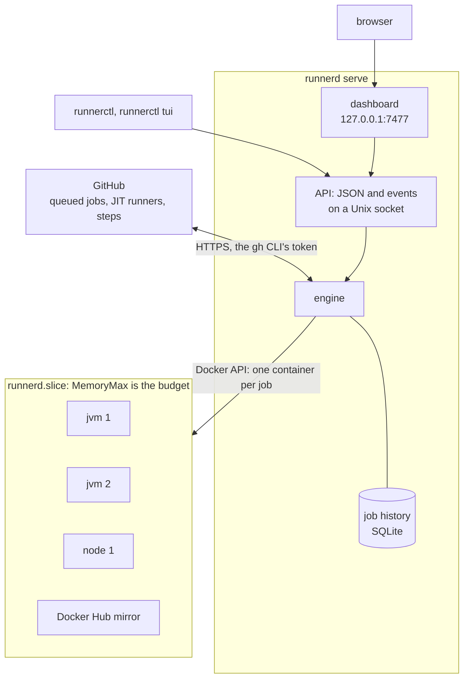

# runnerd

[](https://github.com/ayagmar/runnerd/actions/workflows/ci.yml)
[](https://github.com/ayagmar/runnerd/releases/latest)
[](https://crates.io/crates/runnerd)
[](rust-toolchain.toml)
[](LICENSE)
[](https://ayagmar.github.io/runnerd/)

runnerd runs ephemeral GitHub Actions runners on a Linux host: one fresh container per job, in slots shared by the repositories you configure, kept inside a memory and CPU budget.

It is in early development: the daemon schedules runners, records every job, shares one build cache across every slot that the default branch writes (and, where a repository allows it, its own pull requests), can keep a failed job's runner to open a shell in, advises on each profile's memory and slots from past jobs' peaks and can apply that advice itself, can admit runners by those peaks instead of their caps and by CPU, can run a repository's light jobs in a smaller profile than its heavy ones, says why each queued job waits and what holds the host's memory, serves a JSON API and a web dashboard you can install as an app and reach through a proxy, and `runnerctl` reads and controls it from a terminal.



## First run

On a Linux host with Docker:

```sh
curl -fsSL https://github.com/ayagmar/runnerd/releases/latest/download/install.sh | sh
runnerd init halyard/ledger halyard/storefront
```

Serve only private repositories: on a public one, anyone who opens a pull request can run code on this host
([Configuration](https://ayagmar.github.io/runnerd/configuration/)).

`runnerd init` writes two files and changes nothing else:

- `~/.config/runnerd/runnerd.toml`: the repositories, and one profile with slots of up to 8G, one per 4 CPUs, inside
  three quarters of the host's memory (or the slice's `MemoryMax` if that is smaller), so `runnerd check-config`
  passes;
- `~/.config/systemd/user/runnerd.service`: a user unit running `runnerd serve` with that config.

It then runs `runnerd doctor` and prints what is left as commands. It prints the ones that need root and never runs
them; on a fresh host they are usually the slice, sized for this host, and Sysbox. Run the commands your `init`
printed, not a copy from elsewhere.

Then start the service. The config's profile runs this release's published image,
`ghcr.io/ayagmar/runnerd-runner:base-<version>`, which runnerd pulls before the first runner. Published images are
linux/amd64 only today, so on aarch64 runners do not start yet.

```sh
systemctl --user daemon-reload
systemctl --user enable --now runnerd
runnerctl status
```

Last, `init` prints the line that sends a workflow job to these runners:

```yaml
runs-on: [self-hosted, linux, x64]
```

A job runs here only when every label in its `runs-on` is in its repository's `labels` in `runnerd.toml`; jobs on
`ubuntu-latest` stay on GitHub's runners.

`init` never replaces a file unless given `--force`. `--slice` names another slice, `--config` writes the config
elsewhere.

## Install

The installer downloads `runnerd` and `runnerctl` for Linux x86_64 or aarch64, checks their SHA-256, copies them to
`~/.local/bin` and runs `runnerd doctor`. It never uses sudo. To pick the directory or the release:

```sh
curl -fsSL https://github.com/ayagmar/runnerd/releases/latest/download/install.sh | sh -s -- --prefix /opt/runnerd --version v0.0.14
```

For v0.0.3 and earlier, run that release's own `install.sh`. Every release archive, `install.sh` and `sha256.sum` has
a GitHub build provenance attestation:

```sh
curl -fsSLO https://github.com/ayagmar/runnerd/releases/latest/download/install.sh
gh attestation verify install.sh -R ayagmar/runnerd
sh install.sh
```

From crates.io the daemon is `runnerd` and `runnerctl` is in `runnerd-cli`. `cargo install` needs Rust 1.99 or later;
`cargo binstall` downloads the release archives instead:

```sh
cargo install --locked runnerd runnerd-cli
cargo binstall runnerd runnerd-cli
```

## Requirements

- Linux with cgroup v2, and Docker using the systemd cgroup driver.
- [Sysbox](https://github.com/nestybox/sysbox), so each runner container can run its own Docker Engine without being
  privileged. When it is missing, `runnerd doctor` prints the install commands for Ubuntu, Debian, Arch, and the
  source build on Fedora, CentOS Stream, Rocky, Alma and Amazon Linux. Red Hat Enterprise Linux has Sysbox-EE only.
- A systemd slice whose `MemoryMax` is the budget for all runners; `runnerd init` prints one sized for the host.
- The [GitHub CLI](https://cli.github.com), logged in with the `repo` scope.

`runnerd doctor` checks each of these and prints the fix for what is missing.

## Documentation

The site, <https://ayagmar.github.io/runnerd/>, has the guides:

- [Install](https://ayagmar.github.io/runnerd/install/): requirements, `runnerd init`'s output, verifying a release.
- [Configuration](https://ayagmar.github.io/runnerd/configuration/): `runnerd.toml`, runner images, records of failed jobs, the budget check, isolation, and every key with its default.
- [Admission and sizing](https://ayagmar.github.io/runnerd/admission/): what a job's memory counts, sizing advice from the job history and auto sizing, measured and CPU admission, `runnerd simulate`.
- [Running](https://ayagmar.github.io/runnerd/running/): the service unit and `systemctl`, how runners are scheduled, warm runners that wait for the next job, how caches are kept warm, the shared build cache, records of failed jobs and their shells, the job history, and the JSON API and its events.
- [Dashboard and CLI](https://ayagmar.github.io/runnerd/clients/): the web dashboard, from another device too, every `runnerctl` command, and `runnerctl tui` with its keys.
- [Upgrading](https://ayagmar.github.io/runnerd/upgrading/): what each release changes on an existing host, and what to do before and after.

[ARCHITECTURE.md](https://github.com/ayagmar/runnerd/blob/main/ARCHITECTURE.md) says where the code lives and [docs/adr](https://github.com/ayagmar/runnerd/blob/main/docs/adr/README.md) why.

## Building

```sh
cargo build --release
```

The toolchain is pinned in `rust-toolchain.toml`. Before sending a change, run the checks listed under "The gate" in
[AGENTS.md](https://github.com/ayagmar/runnerd/blob/main/AGENTS.md); CI runs the same. [CONTRIBUTING.md](https://github.com/ayagmar/runnerd/blob/main/CONTRIBUTING.md) explains which CI jobs a change
triggers and how a release is cut.

The tests that start real containers are ignored by default. They need Docker with sysbox and the images:

```sh
docker build --target jvm -t runnerd-runner:jvm image
docker build --target base -t runnerd-runner:base image
cargo test -p runnerd-core --test docker_smoke --test cache_reseed --test slot_docker_store -- --ignored
```

The Gradle build cache test builds its own image from the Gradle image, so it needs the network too:

```sh
cargo test -p runnerd-core --test build_cache_gradle -- --ignored
docker rmi runnerd-test-build-cache
```

## License

MIT
