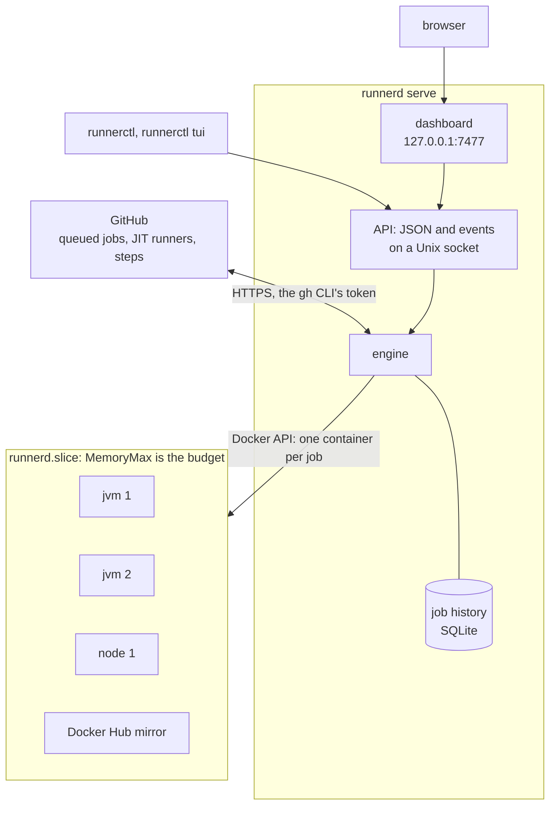

# runnerd

[](https://github.com/ayagmar/runnerd/actions/workflows/ci.yml)
[](https://github.com/ayagmar/runnerd/releases/latest)
[](https://crates.io/crates/runnerd)
[](rust-toolchain.toml)
[](LICENSE)
[](https://ayagmar.github.io/runnerd/)

runnerd runs ephemeral GitHub Actions runners on one Linux host. Each job gets a fresh container; the
repositories you configure share slots inside a memory budget.

- It records every job's memory and CPU use and sizes each profile from it: memory from peaks, CPUs from
  averages and from how often the CPU cap throttled a job, slots from how long jobs waited (`runnerd init` turns
  this on), so you don't tune it by hand.
- Runners share one build cache (Gradle, sccache, Bazel, Turborepo, Nx) that the default branch writes, and
  GitHub Actions' cache is served from the host's disk. A job starts in the slot that ran it last, and a fresh
  runner can wait ready for the next job.
- Every queued job shows why it waits; `runnerctl insights` reports slow and flaky jobs and what
  the minutes would have cost on GitHub-hosted runners.
- A failed job's runner can be kept, so you can open a shell in it.
- Runners are unprivileged: they run under [Sysbox](https://github.com/nestybox/sysbox) with their own Docker Engine.

It is in early development.



## Quick start

```sh
curl -fsSL https://github.com/ayagmar/runnerd/releases/latest/download/install.sh | sh
runnerd init halyard/ledger halyard/storefront
```

`init` writes a config sized for the host and a systemd user unit, then runs `runnerd doctor` and prints the steps
left. It never runs anything as root: it prints those commands (usually the slice and Sysbox) for you to run.

```sh
systemctl --user daemon-reload
systemctl --user enable --now runnerd
runnerctl status
```

Send a job here with:

```yaml
runs-on: [self-hosted, linux, x64]
```

Serve only private repositories: on a public one, anyone who opens a pull request can run code on this host.
`runnerd init` and `runnerd doctor` warn for a public one.

## Requirements

- Linux with cgroup v2, and Docker with the systemd cgroup driver. Published runner images are linux/amd64; on aarch64,
  build the image's `base` stage on the host.
- [Sysbox](https://github.com/nestybox/sysbox). `runnerd doctor` prints install commands for common distros.
- A systemd slice whose `MemoryMax` is the runners' budget; `init` prints one.
- The [GitHub CLI](https://cli.github.com), logged in with the `repo` scope.

Other ways to install (a pinned version, a prefix, attestation checks, `cargo install`) are on the
[Install](https://ayagmar.github.io/runnerd/install/) page.

## Documentation

<https://ayagmar.github.io/runnerd/>:
[Install](https://ayagmar.github.io/runnerd/install/),
[Configuration](https://ayagmar.github.io/runnerd/configuration/),
[Admission and sizing](https://ayagmar.github.io/runnerd/admission/),
[Running](https://ayagmar.github.io/runnerd/running/),
[Insights and notifications](https://ayagmar.github.io/runnerd/insights/),
[Dashboard and CLI](https://ayagmar.github.io/runnerd/clients/).
[ARCHITECTURE.md](https://github.com/ayagmar/runnerd/blob/main/ARCHITECTURE.md) says where the code lives and
[docs/adr](https://github.com/ayagmar/runnerd/blob/main/docs/adr/README.md) why.

## Building

```sh
cargo build --release
```

Before sending a change, run "The gate" in [AGENTS.md](https://github.com/ayagmar/runnerd/blob/main/AGENTS.md);
CI runs the same. [CONTRIBUTING.md](https://github.com/ayagmar/runnerd/blob/main/CONTRIBUTING.md) covers CI jobs
and releases.

Tests that start real containers are ignored by default and need Docker with Sysbox and the images:

```sh
docker build --target jvm -t runnerd-runner:jvm image
docker build --target base -t runnerd-runner:base image
cargo test -p runnerd-core --test docker_smoke --test cache_reseed --test slot_docker_store -- --ignored
```

The Gradle build cache test also needs the network:

```sh
cargo test -p runnerd-core --test build_cache_gradle -- --ignored
docker rmi runnerd-test-build-cache
```

## License

MIT
